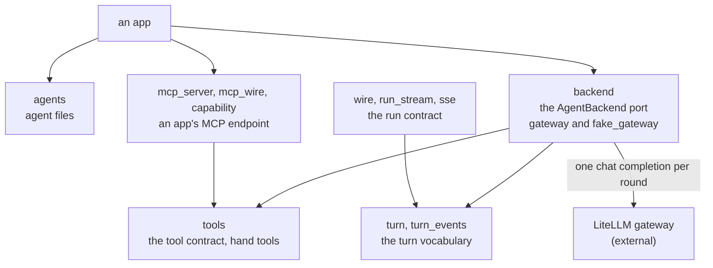

# Architecture

The mental model of this repository, for an engineer who changes it or decides
how an app builds on it. It is an overview: the code and its docstrings own
behaviour, and `AGENTS.md` owns the layout, the checks and the release rules.

## What it is

One light client library, `agent_runtime_client`, for apps that run agent turns
on a model gateway. An app declares its agents in files and its tools in code,
and the client sends each turn to the app's LiteLLM gateway with the app's own
key, runs the tool calls in the app's process and streams the turn back as
typed events. No service, no provider CLI and no subscription login sit in
between. Model providers are reached only through the gateway.

## The client

*Which module an app and its neighbours reach. Source: `src/agent_runtime_client`,
`.importlinter`.*

- The **base** depends on `pydantic` and `ruamel.yaml` only. It holds the
  agent-file reader (`agents`), the tool contract (`tools`), the turn's
  vocabulary (`turn`) and the in-process turn events (`turn_events`), the run
  contract with its stream rules (`wire`, `run_stream`, `sse`), and the backend
  port (`backend`).
- The **`backend` extra** adds `httpx2` for `backend.gateway.GatewayBackend`,
  the one implementation of the port, and `backend.fake_gateway`, its scripted
  transport for tests.
- The **`mcp-server` extra** adds PyJWT with cryptography, and anyio, for
  `agent_runtime_client.mcp_server`, an app's MCP endpoint that verifies the
  run capability (`capability`) and speaks the JSON-only profile (`mcp_wire`).
  It is plain ASGI, and no base module imports it.

The run contract has one owner, `agent_runtime_client.wire`; the turn's
vocabulary has one, `agent_runtime_client.turn`, which `wire` composes.
`agent_runtime_client.turn_events` is the in-process turn event, never a second
wire. The app-facing reference is [wire.md](wire.md).

## Crosscutting concepts

**Host facts come from the host.** The client reaches back into no host. The
gateway origin and key file arrive in the app's `agent` configuration section
(`AgentConfig`), the tool set arrives as `HandTool`s and the MCP tools as the
app's own handlers. No path invents a default for a host fact, and a malformed
value fails loud.

**Trust.**

- *An app holds its own gateway key.* The key has its own budget and limit, sits
  in a file the configuration names, is read per turn and is written to no log.
  Model providers stay reachable only through the gateway.
- *The app owns its tools and their effects.* Tools run in the app, and the app
  alone decides what a call may do. A tool's effect class, `read_only` or
  `side_effecting`, defaults to side-effecting. The class itself never reaches a
  model; the person front shows MCP clients only whether a tool is read-only, as
  `readOnlyHint`.
- *An agent file is read strictly.* It is Claude Code's subagent format, YAML front
  matter between `---` lines with the Markdown body as the prompt, and each
  front-matter field is validated by its own type: a limit must be an integer, and a
  quoted number is refused.
- *A person is known to the gateway only as a fingerprint* of their issuer and
  subject, so no real identifier leaves the app.
- *A capability is verified, not trusted.* The capability front (`McpServer`) accepts a call only
  with a signature that verifies against the public key the app holds. The person front
  (`McpPersonFront`) carries no capability: the host's own authentication gate resolves the
  person before the front serves a call.
