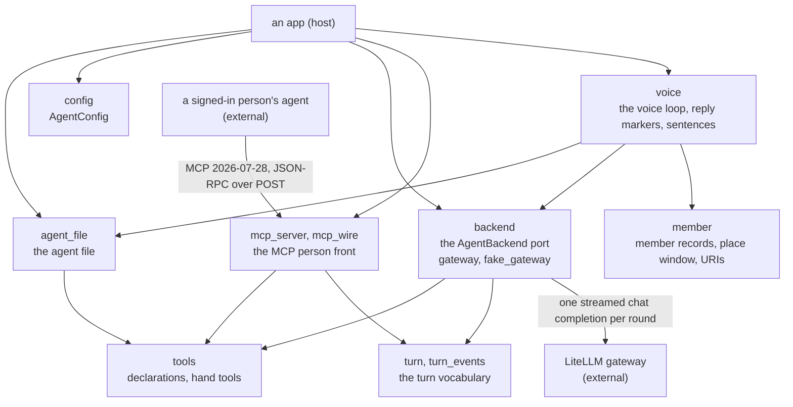
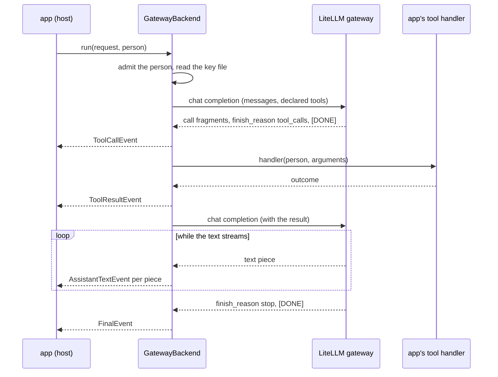

# Architecture

The mental model of this repository, for an engineer who changes the client or decides how an
app builds on it. The code and its docstrings own behaviour, `docs/connector.md` is the
reference for apps and `AGENTS.md` owns the checks and the release rules.

## Context

One library, `agents`, for apps that run agent turns. An app ships its agents as
files and declares its tools in code. The client sends each turn to the app's LiteLLM gateway
with the app's own key, runs the tool calls in the app's process and streams the turn back as
typed events. Model providers are reached only through the gateway.

*Which module an app reaches and what each reaches in turn. Source: `src/agents`,
`.importlinter`.*

## Building blocks

- The **base** depends on `pydantic` and `ruamel.yaml` only: `agent_file` (the agent-file reader),
  `tools` (the tool contract), `turn` (the turn's vocabulary, the one owner of `JsonObject` and
  `JsonDocument`, the size bounds and the failure codes), `turn_events`, `config`, the `backend`
  port and `member` (the records an app and an agent say to each other about a member, the place
  window, the place view and their URIs).
- The **`backend` extra** adds `httpx2` for `backend.gateway.GatewayBackend`, the one
  implementation of the port, and `backend.fake_gateway`, its scripted transport for tests.
- The **`mcp-server` extra** adds `anyio` and the official MCP SDK for
  `agents.mcp_server`, a thin ASGI shell before the SDK that serves an app's tools
  to one signed-in person's agent on MCP revision 2026-07-28, and the `MemberResources` port
  through which a member reads an app's truth per verified principal; `mcp_wire` holds what the
  SDK does not own (the endpoint path, the strict JSON reader, the bearer-reflection check) and
  imports no extra.
- The **`voice` extra** adds `syntok` for `agents.voice`: the voice loop
  (`voice.loop.run_voice_loop`) on the `AgentBackend` port, its ports `VoiceOut` and `WakeRule`
  and its events. `voice.reply` owns the reply markers, the protocol text composed from them and
  the sentence release, `voice.sentences` the syntok split, `voice.conversation` the running
  conversation and the window each decision sends of it, `voice.wake` the standard wake rule, and
  `voice.echo` the echo rule that keeps the agent's own voice, heard back, out of the conversation.

## Runtime

A turn runs inside the app's process. `GatewayBackend.run` admits the person, reads the key
file and streams one chat completion per round: the round's text reaches the app as the model
writes it, and when the round asks for tools the app's handlers run in order once the round is
complete and judged whole, before the next request. One deadline bounds the whole turn. Nothing
persists: the client holds no state between turns, except that the voice loop holds one running
conversation in memory for as long as it runs. The gateway holds the budget.

The voice loop runs in the host's process too. Lines come in from the host's hearing port; the
host's wake rule decides which line starts a decision. One decision is in flight at a time: its
turn is read to its end in one task of the loop's task group while another task plays its
sentences in order through the host's `VoiceOut`, so the turn's deadline bounds the writing,
never the playing. While one sentence plays, a third task renders the next one, never more than
one ahead, so a render taking no longer than the sentence playing before it adds no pause.

One gateway turn with a tool call:

*Source: `backend/gateway.py`, `GatewayBackend.run`.*

The MCP person front is mounted by the host behind the host's own authentication gate. It
resolves the person through a port, answers `tools/list` and `tools/call`, and replays a
marked route as an in-process request into the host's whole application.

Every answer of the front is buffered, so a bearer reflected into it can be withheld whole. The
one streaming path is `subscriptions/listen`, per verified principal: `ResourceChanges` wakes each
open stream of the signalled principal, and the stream acknowledges, delivers and ends at a bound.
The shell's writer checks each frame for the bearer and holds the response start until the first
frame, so a bearer in the first one is still withheld and in a later one cuts the stream. The shell
caps that call at the bound plus time for the completion, because the SDK's write to a client has
no timeout and a client that stops reading would otherwise hold the request forever.

## Deployment

The client is a library: every block runs inside the host app's process, the agent files are
read from the app's own disk and the key from a file the app's configuration names. The
person front is mounted in the host's ASGI application. The LiteLLM gateway is the one
outside service, reached over HTTP with the app's key; the signed-in person's agent reaches
the person front only through the host.

## Crosscutting concepts

**Host facts come from the host.** The client reaches back into no host. The gateway origin and
key file arrive in the app's `agent` configuration section, the tool set as `HandTool`s and
the MCP tools as the app's own handlers. No path invents a default for a host fact, and a
malformed value fails loud.

**Trust.**

- *An app holds its own gateway key.* The key has its own budget and limit, sits in a file the
  configuration names, is read per turn and is written to no log record.
- *The app owns its tools and their effects.* A tool's effect class defaults to
  side-effecting. It never reaches a model; the person front shows MCP clients only whether a
  tool is read-only, as `readOnlyHint`.
- *An agent file is read strictly.* Each front-matter field is validated by its own type: a
  limit must be an integer, and a quoted number is refused.
- *A person is known to the gateway only as a fingerprint* of issuer and subject, so no real
  identifier leaves the app.
- *The person front trusts the host's gate.* It carries no credential check of its own; a
  front reached without the gate's admission is a host defect, and it withholds any answer
  that carries the request's own bearer.

**Proof strategy.** Behaviour is proven through the real entry points: `GatewayBackend.run`
against `FakeGateway`'s scripted transport, `load_agent` against files, and the person front
as an ASGI app driven with real scopes and the SDK's own `Client`. Pure rules (`mcp_wire`, the
turn vocabulary, the streamed-round reader) are called directly. The suite needs no live
provider. `quality / verdict` holds the import contracts, size and clone ratchets, and coverage
over the whole suite.

## Constraints and reasons

- Base modules import no HTTP library and no MCP extra, so an app that only reads agent files
  installs two dependencies.
- The client's own modules import no web framework, even though the MCP SDK depends on one: the
  person front is a thin ASGI shell before the SDK, so a host keeps its own framework and its own
  authentication gate.
- Tool handlers run in the app's process, so a handler sees the app's own state and the client
  never runs a tool anywhere else. What a tool returns still travels to the gateway and the
  provider as part of the conversation.
- The key is read per turn, so a rotated key needs no restart.
- A turn's `person` is always the verified person and the gateway sees a fingerprint, so one
  person has one budget across text and pictures.
- A round is judged whole before anything runs, so a malformed round never runs a handler. Its
  text shows as the gateway streams it, so an app can show or speak the first sentence while the
  model still writes; a turn that then fails ends short, and what showed stays.
- Sound never enters the library: the voice loop's ports carry text, and an import contract keeps
  the speech client out, so the sound stays with the app and the speech service.
- Every heard line that is no echo enters the voice loop's conversation, the agent's own spoken
  line excepted, so the agent hears everything; only a line the host's wake rule accepts costs a
  model call. An echo is a spoken line that repeats the agent's latest answer: its own voice heard
  back through a person's microphone, which would otherwise wake the agent to answer itself.
- Only what was played is recorded, or `[silent]`, so the conversation never claims the agent
  said what it wrote but did not play.
- One decision is in flight and one answer plays, so answers keep their order; a line that wakes
  meanwhile gets exactly one decision after them. Nothing caps the decisions: the person's budget
  at the gateway is the bound.

## Not chosen

- A service between app and gateway: each app reaches the gateway directly and a shared
  process would add a hop and a second place to hold keys. Reopens if several apps need a
  budget or a policy the gateway cannot hold.
- A capability front that verifies run tokens minted elsewhere: no minter remains, because the
  person front authenticates the person through the host's gate. Reopens if a component other
  than the person's agent must call an app's tools.
- A per-turn choice between buffered and streamed rounds: one wire path serves every app, and an
  app that shows only judged text reads `FinalEvent`. Reopens if a gateway model cannot stream.
- A delta event beside a whole-round `AssistantTextEvent`: every app reads assistant text as
  pieces, and `FinalEvent` holds the judged answer. Reopens if an app must tell a round's judged
  text from its pieces before the turn ends.
- Provider CLIs and subscription logins: the gateway is the only route to a model. Reopens if
  the gateway cannot reach a model an app needs.
- The speech service owning the voice loop: it turns speech into text and text into sound and
  does not answer. Reopens if the speech service gains a model of its own.
- A voice service between an agent and an app: a second rights check, a hop and a third place
  that holds what was heard. Reopens if several apps need one loop across their places.
- A provider's realtime session behind the loop's ports: such a session is an agent of its own
  that knows nothing of the app's agent. Reopens if a realtime session can run the app's agent.
- Speaking as a tool the model calls: a tool call runs only after its round is judged whole, so
  speech could not start before the whole answer existed, and every sentence would cost a round.
  The `speak` tool stays for the loop: a runner's `VoiceOut` calls it and the model is never offered
  it. Reopens if a tool call can run while its round is still being written.
- A speech adapter in the library: the app holds the sound and its speech access. Reopens if
  every app ends up writing the same adapter.
- A cap in the loop: the person's budget at the gateway and the app's off switches bound an
  agent. Reopens when the operator turns a cap on.
- Dropping one line per call at the window's bound: it would rewrite the whole prompt on every
  call, so no request would share a prefix with the last. The window drops whole pairs until a
  quarter of it is free. Reopens if no model in use reuses a request's prefix.

## Risks and technical debt

- Gateway replies are parsed with plain `json.loads`, while MCP request bodies go through the
  strict reader that refuses `NaN`, `Infinity` and duplicate keys. A gateway is trusted more
  than a person's agent, but the two paths do not share one rule.
- A tool's result travels to the gateway and the provider as conversation text; the client
  bounds its size but cannot know what it holds.
- An app that stops pulling without closing holds the response open: the deadline is checked at
  its next pull.
- The echo rule is a stopgap that judges text alone: it misses an echo mixed with more words of a
  person, and it drops what a person said when at least half of its words longer than two
  letters, counted without the punctuation at their edges, are the latest answer's. An app counts
  its drops through `EchoDropped`. The rule goes, with `EchoDropped` and its lines in
  `connector.md`, once a measurement of the echo in a room or a hearing that stops while
  the agent speaks, such as a mode of the speech service's browser package, makes it unneeded.
- LiteLLM sends a finish reason of its own when a provider's stream ends cleanly without one, so
  such a cut round reads as complete. Measured through LiteLLM, a cut tool round lost its call, and
  its text showed as the answer.
