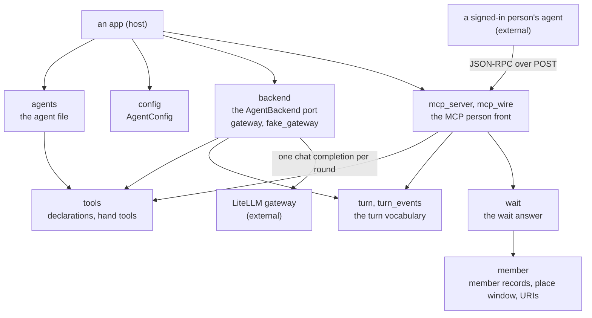
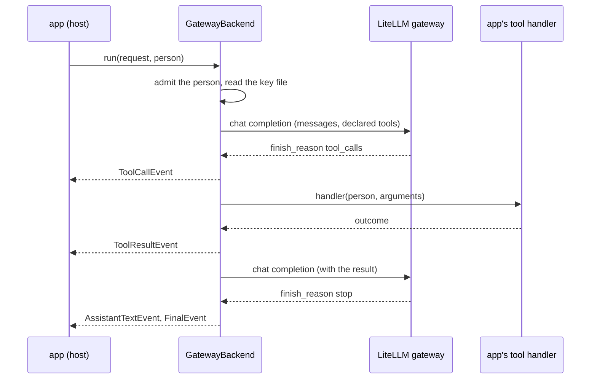

# Architecture

The mental model of this repository, for an engineer who changes the client or decides how an
app builds on it. The code and its docstrings own behaviour, `docs/connector.md` is the
reference for apps and `AGENTS.md` owns the checks and the release rules.

## Context

One library, `agent_runtime_client`, for apps that run agent turns. An app ships its agents as
files and declares its tools in code. The client sends each turn to the app's LiteLLM gateway
with the app's own key, runs the tool calls in the app's process and streams the turn back as
typed events. Model providers are reached only through the gateway.

*Which module an app reaches and what each reaches in turn. Source: `src/agent_runtime_client`,
`.importlinter`.*

## Building blocks

- The **base** depends on `pydantic` and `ruamel.yaml` only: `agents` (the agent-file reader),
  `tools` (the tool contract), `turn` (the turn's vocabulary, the one owner of `JsonObject`,
  the size bounds and the failure codes), `turn_events`, `config`, the `backend` port,
  `member` (the records an app and an agent say to each other about a member, the place window
  and its URIs) and `wait` (the answer records and protocol constants of the wait tool, base so that an agent's
  runner parses an answer without an extra).
- The **`backend` extra** adds `httpx2` for `backend.gateway.GatewayBackend`, the one
  implementation of the port, and `backend.fake_gateway`, its scripted transport for tests.
- The **`mcp-server` extra** adds `anyio` for `agent_runtime_client.mcp_server`, plain ASGI
  that serves an app's tools to one signed-in person's agent, the `wait` tool with its two ports
  among them; `mcp_wire` holds its pure JSON-RPC rules and imports no extra.

## Runtime

A turn runs inside the app's process. `GatewayBackend.run` admits the person, reads the key
file, sends one chat completion per round and, when a round asks for tools, runs the app's
handlers in order before the next request. One deadline bounds the whole turn. Nothing
persists: the client holds no state between turns, and the gateway holds the budget.

One gateway turn with a tool call:

*Source: `backend/gateway.py`, `GatewayBackend.run`.*

The MCP person front is mounted by the host behind the host's own authentication gate. It
resolves the person through a port, answers `tools/list` and `tools/call`, and replays a
marked route as an in-process request into the host's whole application.

## Deployment

The client is a library: every block runs inside the host app's process, the agent files are
read from the app's own disk and the key from a file the app's configuration names. The
person front is mounted in the host's ASGI application. The LiteLLM gateway is the one
outside service, reached over HTTP with the app's key; the signed-in person's agent reaches
the person front only through the host.

## Crosscutting concepts

**Host facts come from the host.** The client reaches back into no host. The gateway origin and
key file arrive in the app's `agent` configuration section, the tool set as `HandTool`s and
the MCP tools as the app's own handlers. No path invents a default for a host fact, and a
malformed value fails loud.

**Trust.**

- *An app holds its own gateway key.* The key has its own budget and limit, sits in a file the
  configuration names, is read per turn and is written to no log record.
- *The app owns its tools and their effects.* A tool's effect class defaults to
  side-effecting. It never reaches a model; the person front shows MCP clients only whether a
  tool is read-only, as `readOnlyHint`.
- *An agent file is read strictly.* Each front-matter field is validated by its own type: a
  limit must be an integer, and a quoted number is refused.
- *A person is known to the gateway only as a fingerprint* of issuer and subject, so no real
  identifier leaves the app.
- *The person front trusts the host's gate.* It carries no credential check of its own; a
  front reached without the gate's admission is a host defect, and it withholds any answer
  that carries the request's own bearer.

**Proof strategy.** Behaviour is proven through the real entry points: `GatewayBackend.run`
against `FakeGateway`'s scripted transport, `load_agent` against files, and the person front
as an ASGI app driven with real scopes. Pure rules (`mcp_wire`, the turn vocabulary) are called
directly. The suite needs no live provider. `quality / verdict` holds the import contracts,
size and clone ratchets, and coverage over the whole suite.

## Constraints and reasons

- Base modules import no HTTP library and no MCP extra, so an app that only reads agent files
  installs two dependencies.
- The client imports no web framework: the person front is plain ASGI, so a host keeps its own
  framework and its own authentication gate.
- Tool handlers run in the app's process, so a handler sees the app's own state and the client
  never runs a tool anywhere else. What a tool returns still travels to the gateway and the
  provider as part of the conversation.
- The key is read per turn, so a rotated key needs no restart.
- A turn's `person` is always the verified person and the gateway sees a fingerprint, so one
  person has one budget across text and pictures.
- A round is judged whole before anything shows or runs, so a malformed round never runs a
  handler.

## Not chosen

- A service between app and gateway: each app reaches the gateway directly and a shared
  process would add a hop and a second place to hold keys. Reopens if several apps need a
  budget or a policy the gateway cannot hold.
- A capability front that verifies run tokens minted elsewhere: no minter remains, because the
  person front authenticates the person through the host's gate. Reopens if a component other
  than the person's agent must call an app's tools.
- Streaming gateway responses: rounds are buffered so a round is judged whole before it shows.
  Reopens if an app needs token-by-token output.
- Provider CLIs and subscription logins: the gateway is the only route to a model. Reopens if
  the gateway cannot reach a model an app needs.
- Folding `AnnotatedToolDefinition` into `ToolDefinition`: the person front's listing carries
  `readOnlyHint`, which a plain definition does not. Reopens if the annotation leaves the
  listing.

## Risks and technical debt

- Gateway replies are parsed with plain `json.loads`, while MCP request bodies go through the
  strict reader that refuses `NaN`, `Infinity` and duplicate keys. A gateway is trusted more
  than a person's agent, but the two paths do not share one rule.
- A tool's result travels to the gateway and the provider as conversation text; the client
  bounds its size but cannot know what it holds.
