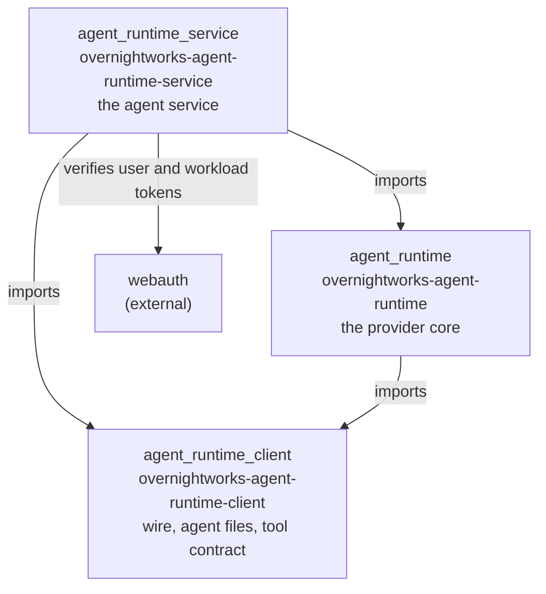
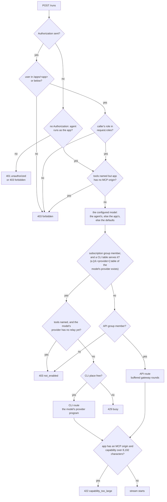
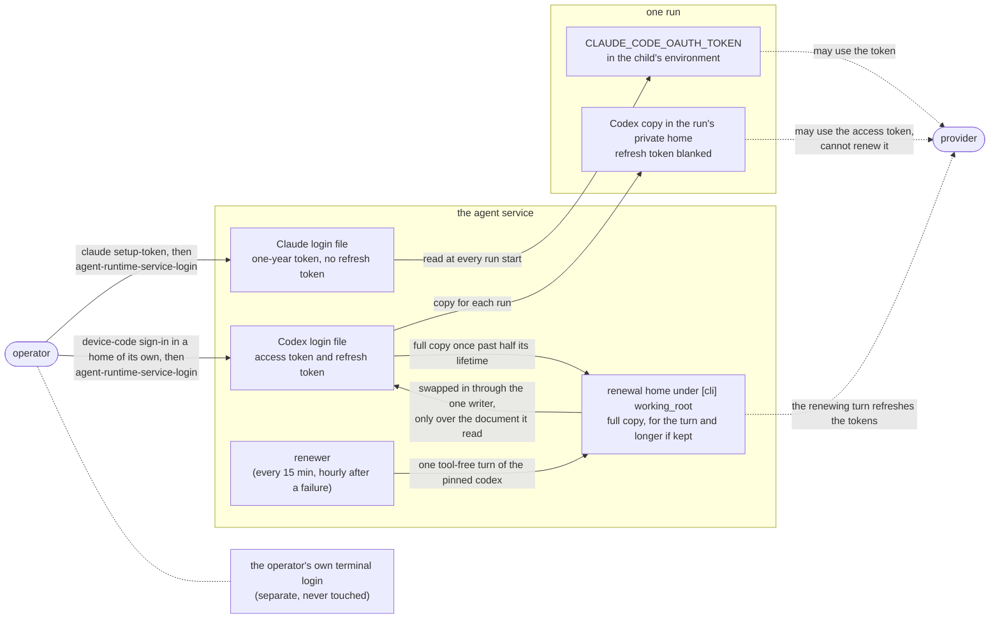

# Architecture

The mental model of this repository, for an engineer who changes it or decides
how a host or an app builds on it. It is an overview: the code and its
docstrings own behaviour, the decision record
[0001](decisions/0001-agent-service.md) owns the service's rulings, and
`AGENTS.md` owns the layout, the checks and the release rules.

## What it is

A library and the service built on it. The library routes a turn to Claude,
Grok or Codex over each provider's CLI or HTTP API and owns the machinery a host
should not rebuild: live model catalogs, readiness probes, a streaming turn
transport, the tool loop, a bounded subprocess runner and the sandbox
directory-name constants. The service is the one authenticated entrance through
which apps start agent runs: one agent service decides who is asking, whether
they may use the operator's subscription, and which route serves them. An app
that starts runs through the service holds no LLM or subscription credential, and
its tools stay with the app.

## The three distributions

Released together from one tag, built in one workspace. The import direction is
enforced by `.importlinter`, which `lint-imports` proves in CI.

*Which package may import which. Source: `.importlinter`, the three
`pyproject.toml` files. Nothing imports the service; only the service imports
`webauth`.*

- The **client** is light: it depends on `pydantic` and `ruamel.yaml` only (plus
  PyJWT with cryptography in `[mcp-server]`) and never imports the core. It owns
  the tool contract `ToolDeclaration`, the agent-file reader, the service's wire
  (the `RunRequest` and the streamed run events), the run capability's format and
  the app side of the MCP profile. An app installs it.
- The **core** depends on the client, `pydantic`, `httpx` and `anyio`, and on
  nothing else: no host application, no web framework, no database. A host
  that runs turns itself installs it.
- The **service** builds on both, runs as `agent-runtime-service --config PATH`, and
  alone depends on a web framework.

The service's wire has one owner, `agent_runtime_client.wire`. The core's in-process
turn event (`agent_runtime.events`) is never a second wire; `agent_runtime_service.run_events`
maps it onto the wire.

## How a run is routed

The service decides the route from the caller's groups and the model the
configuration names for the agent (the request's agent picks it), never from the request. Every
check precedes any child process.

*Question: which route serves this caller? Source:
`agent_runtime_service.app._admitted`, `agent_runtime_service.routing.route`. The groups and models are
operator configuration ([operations.md](operations.md)). An app's own run is routed from the
groups its workload token carries.*

Keycloak decides who may use the subscription and who the paid route, through
groups of a person, or for an app's own run of its service account; the service holds no user list. The configured model is never replaced by
another. The independently installed API runner sends the configured full
`<provider>/<model>` name through the core's OpenAI-compatible conversation adapter. Each
round is checked before releasing text or invoking granted MCP tools. The API route
uses the same tool-call and result acceptance barrier as the subscription route,
without a CLI listener. Service supervision continues heartbeats and time limits
while HTTP or tools wait. [The wire contract](wire.md#api-text-results) owns the
round, privacy and acceptance rules. `identity.api_groups` and `[api]` come together;
either alone stops startup. Credential selection and rotation are described in
[operations.md](operations.md#configure-the-api-text-route).

## How a run gets its login

The operator signs in once per provider; the service keeps that login in one file
and gives every run only a copy that can use it, never renew it. Exactly one
holder keeps a refresh token, and it is never a run. For a Codex login the service
renews that file itself, on a full copy that lives for the turn, and longer when the end is
unconfirmed or the result could not be swapped in.

*Question: where does each provider's subscription login live, and what does a run
hold? Source: [operations.md](operations.md) (the login file and the login
command), `agent_runtime.codex_login.blanked_copy`, `agent_runtime.claude.run`,
`agent_runtime_service.renewal` and `agent_runtime_service.renewal_schedule`, and the decision
record [0001](decisions/0001-agent-service.md) (A1b-K0, the measured lifetime; A1b-R1, the renewal).*

- **Claude.** `claude setup-token` prints a one-year token that has no refresh
  token; the operator swaps it by hand. The service reads the file at every run
  start and hands the token to the child only as `CLAUDE_CODE_OAUTH_TOKEN`.
- **Codex.** A dedicated service login, separate from the operator's own terminal
  login: two logins sharing one refresh token would rotate each other's away. A
  run gets a `0600` copy in its private run home with `refresh_token` blanked, so it
  can use the access token (about 240 hours measured) but cannot renew it.
- **Grok.** The service has no Grok login table today (a `[cli.grok]` table is refused); the route is not built.
- **Who renews.** The service renews a Codex login itself, from its own lifespan: at start
  and then about every 15 minutes, hourly after a failed attempt. Once the access token has
  less than half its lifetime left, one tool-free turn of the pinned `codex` runs on a full
  copy in a private renewal home, and the result is swapped in through the one login writer
  only over the document it renewed. Runs keep their blanked copies and never renew. The
  operator signs in again only when a renewal fails for good; no lifetime is promised
  beyond what was measured. A Claude login has no refresh token and is the operator's to
  swap.

## Crosscutting concepts

**Host facts come from the host.** The library reaches back into no host.
Deployment facts arrive as configuration (`ProviderRuntimeConfig`) or explicit
arguments; the tool set, the MCP server and the image constraints arrive as
ports (`ToolExecutor`, `ToolCatalog`, `McpServerSpec`, `ImagePolicy`). No path
invents a default for a host fact, and an unconfigured path fails loud.

**One spawn owner, one bounded runner.** Every child is a `ChildProcess` with a
complete environment, an absolute binary and an explicit working directory,
created only in `agent_runtime.spawn`. The environment is closed by
convention, not access control; containment is the host's sandbox and the
service's container ([host.md](host.md)).

**Trust.**

- *The issuer is the trust root.* The service alone verifies user and workload
  tokens, against the one configured issuer; identity is the verified `(iss,
  sub)`, never a field of the request body.
- *The service decides, the browser supplies nothing.* The user's browser reaches
  the service only as the access token its app forwards. The app gate and the
  caller's role come from the verified tokens. The request, sent by the app under
  its workload token, supplies the agent's allowed roles and its tools; configuration
  decides the rest, the model included. It carries no MCP URL, MCP
  token, route or user id.
- *An app runs as itself only for the agents the operator enabled.* The principal of
  an app's own run is its service account, and its route comes from that account's groups.
  The list (`runs_as_app`) is an aid for a cooperative app; the boundary is the groups.
- *The app owns its tools and their effects.* Tools run in the app, behind its one
  registered MCP origin. The request names the tools and their effects; the
  service signs a per-run capability that grants exactly those names, and the app
  verifies it with the public key ([wire.md](wire.md) has the details).
- *No credential in an app.* The subscription login is one file the operator
  names; an app that starts runs through the service holds none (the interim core
  path in [operations.md](operations.md) is the exception).
